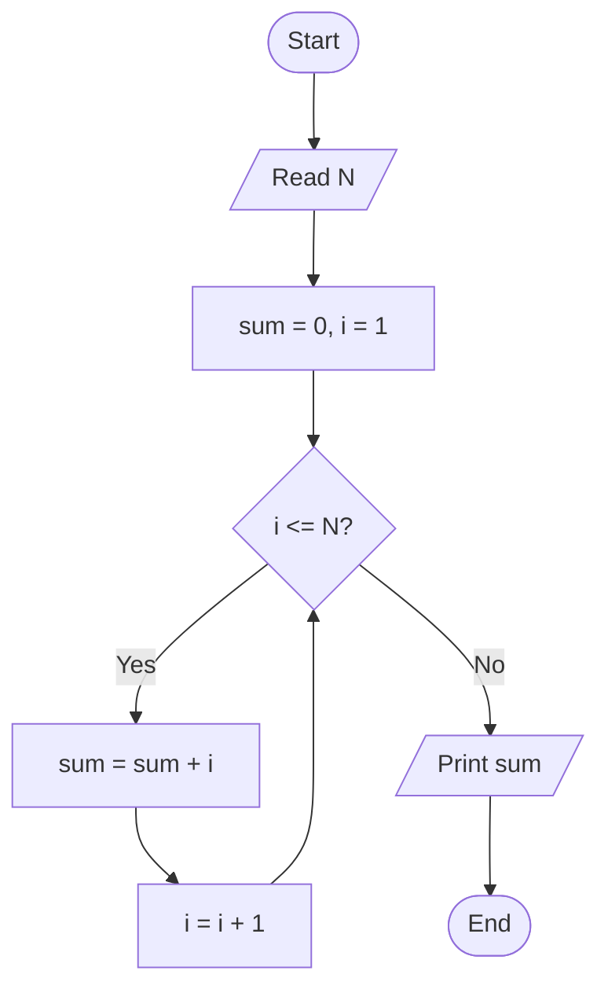

### ALGORITHM

- Step-by-step, finite set of instructions to solve a problem
- Must have: input, output, definiteness (clear steps), finiteness (ends),
effectiveness (doable)
- Flow of work: Problem -> Algorithm -> Flowchart/Pseudocode -> Code -> Test

#### FLOWCHART SYMBOLS

- Oval Start / End
- Parallelogram Input / Output
- Rectangle Process (calculation, assignment)
- Diamond Decision (yes/no, true/false)
- Arrow Direction of flow
- Circle Connector (jump to another part/page)

Rules:

- One Start, one End
- Flow goes top to bottom, left to right
- Diamond has 2 exits (Yes/No) labelled
- Arrows never cross where avoidable
- Keep each box to one idea

### PSEUDOCODE

- Plain-English, code-like description of logic, no strict syntax
- Not tied to any language

#### Common keywords:

- START / END, READ / INPUT, PRINT / DISPLAY
- IF ... THEN ... ELSE ... ENDIF
- WHILE ... DO ... ENDWHILE
- FOR i = 1 to N ... ENDFOR
- SET x = x + 1   (or x <- x + 1)

Rules:

- One statement per line
- Indent inside IF / loops
- Use clear variable names
- Start with START, finish with END

### COMPARISON

1. Algorithm : written steps, any style
2. Flowchart : graphical, easy to see the flow, hard to edit for big programs
3. Pseudocode : text, close to code, easy to convert to a program

### DRY RUN (tracing)

- Run the algorithm by hand with sample input
- Make a table: one column per variable, one row per step
- Purpose: catch logic mistakes before coding
- Always test: normal case, zero/empty, smallest, largest, negative

WORKED EXAMPLE: Sum of numbers from 1 to N

```
START
  READ N
  SET sum = 0
  SET i = 1
  WHILE i <= N
    SET sum = sum + i
    SET i = i + 1
  ENDWHILE
  PRINT sum
END
```

FLOWCHART 



DRY RUN (N = 4)

```
Step | i | sum | i <= N?
 1   | 1 |  0  | yes
 2   | 2 |  1  | yes
 3   | 3 |  3  | yes
 4   | 4 |  6  | yes
 5   | 5 | 10  | no -> print 10
```

C++ VERSION

```cpp
int n, sum = 0;
cin >> n;
for (int i = 1; i <= n; i++) sum += i;
cout << sum;
```

MISTAKES TO REMEMBER

- Forgetting to update i -> infinite loop
- Starting sum at 1 instead of 0
- Wrong condition (< instead of <=)